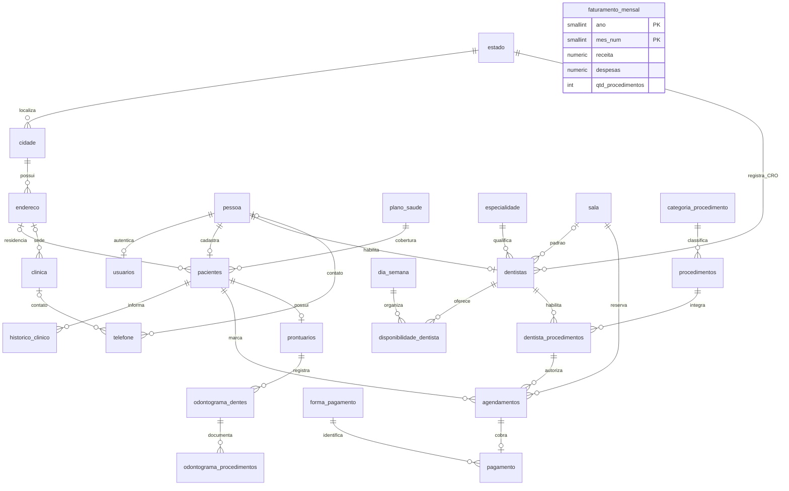

# Modelo de dados

PostgreSQL, 25 tabelas, 7 views. `pessoa` reúne a identidade civil; os perfis guardam apenas seus atributos próprios. O e-mail de `usuarios` é a credencial de login; o de `pessoa` é contato, podendo ser diferente.

## Análise das formas normais

| Forma | Antes | Depois |
|---|---|---|
| 1FN | `horarios` e `dias_atendimento` em `TEXT[]`; principal e emergência em colunas repetidas; medicamentos, alergias e condições como listas em texto | Uma linha por telefone, ocorrência clínica e combinação dentista/dia/hora |
| 1FN — decomposição de domínio | CRO junta UF e registro; endereço junta logradouro e número | `cro_uf`/`cro_numero`, `logradouro`/`numero`/`complemento`. A decomposição atende ao uso independente desses componentes; uma string composta não viola automaticamente a 1FN |
| 2FN | As entidades antigas têm PK simples: não foi encontrada dependência parcial de chave composta. A relação dentista/procedimento já contém apenas a chave | Relações N:N e disponibilidade têm PKs compostas e nenhum atributo dependente de apenas uma parte da chave |
| 3FN | Nome, CPF, nascimento e telefone duplicados em usuário/paciente/dentista; cargo depende de tipo | Dados civis em `pessoa`, telefones em `telefone`; vínculo único por perfil; cargo calculado na view |
| 3FN | Cidade e UF repetidas no endereço; especialidade, categoria, plano, sala e forma de pagamento como textos recorrentes | `estado`, `cidade`, `endereco` e catálogos referenciados por FK |
| 3FN | Sala como texto na agenda; forma de pagamento e indicador pago no agendamento | FK para `sala`; `pagamento` com forma, valor e `pago_em`; `pago` derivado da confirmação |
| Chave e semântica financeira | ID artificial mais UNIQUE ano/mês | PK `(ano, mes_num)`; fechamento mensal consolidado, independente da agenda operacional |

CEP não é chave única de endereço: há vários imóveis no mesmo CEP. A UF depende da cidade identificada, não apenas de seu nome (que pode se repetir entre estados). O endereço referencia uma cidade, que referencia a UF; os componentes não são duplicados no paciente ou na clínica.

## Relações

## Integridade e compatibilidade

- Telefone contém somente dígitos: DDD brasileiro válido, fixo com oito dígitos ou celular com nove começando por 9. O CHECK XOR exige pessoa ou clínica. Índices parciais limitam o principal; o número é único por titular, podendo repetir entre pessoas.
- CPF tem onze dígitos, UNIQUE e verificação em PL/pgSQL. CRO é único por UF/número. Numeração FDI aceita dentes permanentes (11–48, finais 1–8) e decíduos (51–85, finais 1–5).
- Agenda exige procedimento habilitado para o dentista e impede início simultâneo para dentista, paciente ou sala, exceto cancelamentos. Estes índices comparam início, não sobreposição pela duração do procedimento.
- Dados clínicos e financeiros usam `ON DELETE RESTRICT`. Substituir uma lista clínica pelo adapter é uma edição explícita; remover paciente não apaga seu histórico automaticamente.
- Um registro de pagamento por agendamento representa a cobrança integral. `pago_em` nulo indica cobrança pendente; não nulo indica confirmação. Não há parcelamento neste modelo.
- Todas as datas de auditoria usam TIMESTAMPTZ; views convertem timestamps antigos para o formato de leitura legado. Colunas `atualizado_em` são mantidas por triggers.
- `vw_usuarios`, `vw_pacientes`, `vw_dentistas`, `vw_agendamentos`, `vw_clinica`, `vw_procedimentos` e `vw_enderecos` remontam nomes, formatação e listas esperados pelas páginas. O adaptador escreve nas tabelas base, em transações, sem persistir cargo ou pago como colunas.
- Telefone inválido é ignorado e registrado em `error_log`; os outros campos válidos continuam sendo salvos. Campo de emergência vazio remove esse contato opcional.

## Dados de demonstração

Os JSONs originais permanecem intactos. O gerador compartilha a pessoa quando há `id_usuario` legítimo, produz CPFs fictícios válidos distintos por pessoa e preserva os hashes bcrypt legados. Os hashes dos novos usuários também aceitam `123456`.

O legado contém quatro dentistas, preservados para que a comparação não perca registros. O seed tem um dono, quatro dentistas, duas recepcionistas, dez pacientes e três logins de cliente (os outros pacientes não tinham usuário vinculado). Foram acrescentados dois pacientes e dez consultas preventivas concluídas e pagas; toda a carteira tem prontuário e odontograma. As sequências são alinhadas com `pg_get_serial_sequence`.

`schema.sql` e `seed.sql` inicializam um banco vazio. Para um banco antigo em uso, faça backup e migre os dados antes de trocar o schema; o gerador deste projeto importa os JSONs de demonstração, não dados de produção.
